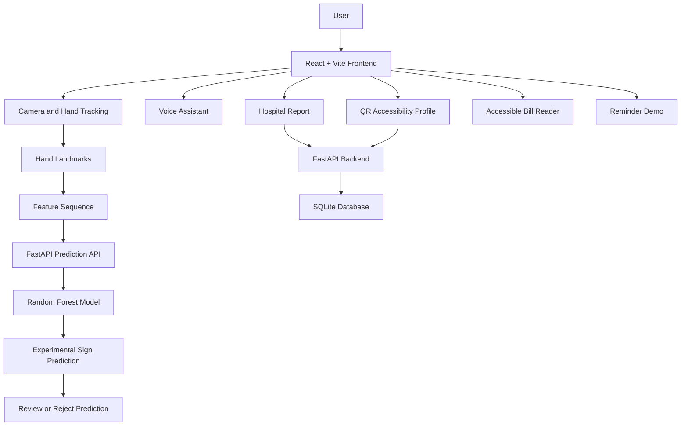

# 🌐 UnderstandMe — Accessible Communication for Everyone


**UnderstandMe** is an accessibility-focused web application prototype that helps people communicate their needs through hospital reports, voice assistance, temporary QR-based accessibility profiles, accessible bill reading, and reminder demonstrations.

The project also includes experimental Indian Sign Language (ISL) recognition for four trained sign categories.

## 👥 Team — The Digital Minds

| Team member       | Role                                |
| ----------------- | ----------------------------------- |
| Harish M          | Project development and integration |
| Mohnish Priyan B  | Frontend and user experience        |
| Shabarish Kumar D | Backend and API integration         |
| Sathesh V         | Testing and demonstration           |

*The roles above are suggested areas of contribution and can be updated to reflect the team's actual work.*

---

## 🖼️ Application Preview

Add your own screenshots from the running website to the `docs/images/` folder.

### Hospital Report and ISL Recognition


### Accessible Voice Assistant


### Temporary QR Accessibility Profile


### Accessible Bill Reader


### Reminder Demonstration


---

## 🎯 Problem Statement

People with disabilities and communication barriers can experience difficulties when communicating their needs in hospitals and service environments.

Deaf or non-speaking patients may require alternative ways to express symptoms. People with visual impairments may need spoken information, while users with different language preferences may need more accessible ways to understand and share information.

Repeating communication preferences at multiple service counters can be tiring, and misunderstandings can make interactions more difficult.

There is a need for accessible communication tools that help people share their needs clearly while maintaining control over their personal information.

## 💡 Proposed Solution

UnderstandMe combines multiple accessibility features in one web application.

The prototype allows users to prepare a hospital communication report, interact with a guided voice assistant, create a temporary QR-based accessibility profile, listen to a sample invoice, and demonstrate a reminder workflow.

An experimental ISL classifier attempts to recognise four trained categories from hand-landmark sequences. Predictions must be reviewed because incorrect recognition is possible.

## ✨ Key Features

### 🏥 1. Hospital Communication Report

- Enter patient details and symptoms.
- Record duration, allergies, urgency, and additional notes.
- Choose from quick communication phrases.
- Read the report aloud.
- Review the information before submitting.
- Save demonstration reports in SQLite.

### 🤟 2. Experimental ISL Sign Recognition

- Live webcam preview.
- Hand tracking with MediaPipe.
- Hand-landmark feature extraction.
- Machine-learning prediction through FastAPI.
- Confidence estimates and provisional rejection of uncertain predictions.
- Manual phrase alternatives when recognition is unsuccessful.

**Current labels:**

| Label    | Example message                    |
| -------- | ---------------------------------- |
| `doctor` | I need a doctor.                   |
| `help`   | I need help.                       |
| `hot`    | I feel hot or feverish.            |
| `thief`  | I need to report a safety concern. |

The classifier supports only these four trained labels. It is an experimental demonstration, not a complete ISL translator.

### 🎙️ 3. Accessible Voice Assistant

- Reads instructions aloud.
- Listens for one voice command at a time.
- Supports voice dictation of symptoms.
- Reads the report aloud.
- Allows voice-requested submission with confirmation.

Voice input depends on browser support and microphone permissions.

### 📱 4. Temporary QR Accessibility Profile

- Create an accessibility profile.
- Set a preferred language and support notes.
- Generate a QR code linked to a temporary profile.
- Set an expiry time.
- Revoke a profile link.
- Display an active profile in the staff view.

### 🔊 5. Accessible Bill Reader

- Displays a fictional invoice.
- Reads invoice information aloud.
- Demonstrates a simulated payment confirmation.

No actual payment is processed.

### ⏰ 6. Reminder Demonstration

- Enter a reminder label.
- Select a reminder time.
- Display reminders saved during the current page session.

This prototype does not schedule real notifications.

---

## 🛠️ Technology Stack

\<p align="center">
&#x20; \
&#x20; \
&#x20; \
&#x20; \
&#x20; \
&#x20; \
\</p>

| Technology     | Purpose                                       |
| -------------- | --------------------------------------------- |
| React          | Frontend user interface                       |
| Vite           | Development server and frontend build         |
| Python         | Backend and model-training logic              |
| FastAPI        | Backend REST API                              |
| SQLite         | Local demo database                           |
| MediaPipe      | Hand-landmark detection                       |
| OpenCV         | Video processing during training              |
| scikit-learn   | Random Forest classifier                      |
| Joblib         | Saving and loading the trained model          |
| `qrcode.react` | QR code generation                            |
| Web Speech API | Browser speech recognition and text-to-speech |
| Git and GitHub | Version control and project collaboration     |

---

## 🏗️ System Architecture



### ISL Feature Processing

The current model expects:

- 12 sampled frames per prediction.
- 126 feature values per frame.
- 1,512 numerical input values per prediction request.

The training and live inference pipelines must use consistent landmark extraction, preprocessing, and frame sampling. Reliable recognition on unseen webcam recordings has not yet been established.

---

## 📂 Project Structure

```text
UnderstandMe-Starter/
├── backend/
│   ├── main.py
│   ├── requirements.txt
│   ├── test_main.py
│   ├── understandme.db
│   └── isl_training/
│       ├── train_model.py
│       ├── hand_landmarker.task
│       ├── isl_rf.joblib
│       └── training_report.json
├── frontend/
│   ├── index.html
│   ├── package.json
│   ├── package-lock.json
│   ├── vite.config.js
│   └── src/
│       ├── App.jsx
│       ├── main.jsx
│       └── style.css
├── isl_dataset/
│   ├── doctor/
│   ├── help/
│   ├── hot/
│   └── thief/
├── docs/
│   └── images/
│       ├── hospital-report.png
│       ├── voice-assistant.png
│       ├── qr-profile.png
│       ├── accessible-bill.png
│       └── reminder.png
└── README.md
```

This is an illustrative structure. Keep the actual folder and file names used in your repository. Generated model files and the database may not be included in a shared ZIP.

---

## ⚙️ Installation and Setup

### Prerequisites

- Python and compatible backend dependencies.
- Node.js and npm.
- A modern browser such as Chrome or Edge.
- A webcam and microphone for camera and speech features.
- Internet access for dependencies and configured browser libraries.

### Step 1 — Clone the repository

```bash
git clone YOUR_GITHUB_REPOSITORY_URL
cd UnderstandMe-Starter
```

Replace `YOUR_GITHUB_REPOSITORY_URL` with your actual repository URL.

### Step 2 — Start the backend

```powershell
cd backend
py -m venv .venv
.venv\Scripts\activate
py -m pip install -r requirements.txt
py -m uvicorn main:app --reload --host 127.0.0.1 --port 8000
```

Keep the backend terminal open.

### Step 3 — Start the frontend

Open a second terminal from the project root:

```powershell
cd frontend
npm install
npm.cmd run dev
```

Open the local URL printed by Vite. It is commonly `http://localhost:5173/`, but Vite may select another port if the default is already in use.

Keep both terminals running.

### Step 4 — Verify the API

- Health check: `http://localhost:8000/health`
- API documentation: `http://localhost:8000/docs`
- ISL status: `http://localhost:8000/api/isl/status`

The backend must be running for report saving, QR profile operations, and ISL predictions.

---

## 🔌 API Endpoints

| Method | Endpoint                   | Description                       |
| ------ | -------------------------- | --------------------------------- |
| GET    | `/health`                  | Backend health status             |
| GET    | `/api/isl/status`          | ISL model availability            |
| POST   | `/api/isl/predict`         | Predict a supported sign category |
| POST   | `/api/profiles`            | Create a temporary profile        |
| GET    | `/api/profiles/{token}`    | Read an active profile            |
| DELETE | `/api/profiles/{token}`    | Revoke a profile                  |
| POST   | `/api/reports`             | Save a hospital report            |
| GET    | `/api/reports/{report_id}` | Retrieve a saved report           |

Refer to the running FastAPI documentation for the exact request and response formats.

---

## 🧪 Model Training

The training script processes videos in the four dataset folders, extracts hand landmarks, and trains a Random Forest classifier.

Expected class folders:

```text
isl_dataset/
├── doctor/
├── help/
├── hot/
└── thief/
```

The training script also expects `hand_landmarker.task` at the configured path in `backend/isl_training/`.

Install the required packages in the backend environment and run the script using its actual path in your project:

```powershell
py -m pip install opencv-python mediapipe numpy scikit-learn joblib
py .\isl_training\train_model.py
```

The script generates a model file and an initial evaluation report. Initial held-out accuracy does not guarantee live webcam accuracy.

---

## ✅ Testing Checklist

- [x] Frontend builds successfully.
- [x] Backend starts without errors.
- [x] Health endpoint responds successfully.
- [x] Required ISL model asset is present.
- [x] Camera permission and hand tracking work.
- [x] Supported signs are tested using new webcam recordings.
- [x] Uncertain predictions can be rejected.
- [x] Manual hospital phrases work.
- [x] Hospital reports can be saved and retrieved.
- [x] QR profiles can be created and revoked.
- [x] Bill read-aloud works.
- [x] Reminder entries appear on the page.
- [x] Voice features work in the chosen browser.
- [x] A clean copy of the project can be installed and started.

---

## 🔒 Privacy and Security

- Use fictional information in the hackathon demonstration.
- Camera frames are processed in the browser for hand tracking; numerical landmark features are sent to the configured prediction API.
- The application is a prototype, not a production medical-record platform.
- Do not commit passwords, access tokens, personal records, database dumps, or private videos.
- Review dataset licensing and permissions before redistribution.
- A production deployment requires appropriate authentication, authorization, HTTPS, restricted CORS, data-retention controls, and security testing.

## ⚠️ Known Limitations

1. The experimental ISL classifier has only four trained categories.
2. A predicted sign may be wrong even when the model reports high confidence.
3. Live and training preprocessing require further consistency checks.
4. The full interface translation dictionary covers English, Tamil, and Hindi; other language options may fall back to English.
5. Voice support depends on the browser and device.
6. Billing is simulated, and reminders do not send notifications.
7. The application is not a diagnosis tool or replacement for healthcare professionals or qualified sign-language interpreters.

## 🚀 Future Enhancements

- Standardize training and live inference preprocessing.
- Validate recognition on unseen signers and webcam recordings.
- Improve unknown-sign rejection.
- Expand the vocabulary with suitable labelled data.
- Improve language translation and accessibility testing.
- Add production-grade authentication and data protection.
- Deploy the frontend and backend as separate services and test the complete hosted workflow.

## 👏 Acknowledgements

UnderstandMe was developed by **The Digital Minds** as an accessibility-focused hackathon prototype, using React, FastAPI, MediaPipe, scikit-learn, SQLite, and browser speech APIs.

Add the exact datasets, references, and third-party resources used by your team, following their licensing and attribution requirements.

---

\<p align="center">
&#x20; \<strong>UnderstandMe — Making communication more accessible.\</strong>
\</p>
